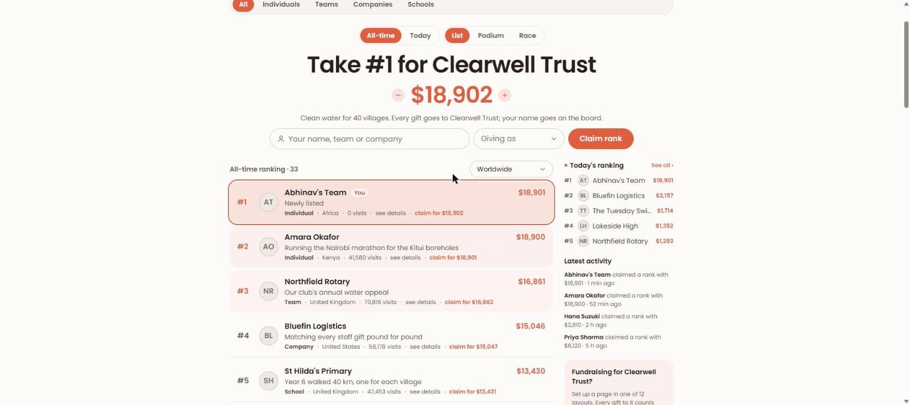

# Outgive

A white-label fundraising platform with a live-fundraising layer. A charity signs up, connects Stripe, brands its board and runs
campaigns, fundraiser pages, teams, challenges, events and in-memory pages on its own domain. Supporters hold ranks by what they
have given; anyone can take a rank by giving more than the person above them. Donors pay by card, Apple Pay, Google Pay or Link
through Stripe Checkout, get an emailed receipt, and watch their name climb a live board or wall display.

Design: `docs/superpowers/specs/2026-10-23-platform-design.md`. Deployment: `docs/RUNBOOK.md`.

Also included: a seven-step create flow (fundraiser, campaign, team, challenge, event, in memory) and 12 page layouts.
Every gift to a fundraising page counts toward that page's rank on the board.

Built with React 19, Vite, Tailwind CSS v4 and the open-source Untitled UI React components.

## Run it

    npm install
    npm run dev          # http://localhost:5173: with no .env the app runs the demo on an in-browser Postgres (PGlite)
    npm test             # schema, SQL API, RLS, seed, money and routing tests on real Postgres (PGlite)
    npm run test:fn      # Deno tests for the edge functions (fee maths, webhook mapping)
    npm run build        # production build in dist/ with prerendered marketing pages
    npm run test:browser # headless Chrome: every route, the claim/record/create flows, and a phone gift landing on the live screen

Copy `.env.example` to `.env.local` and fill in the Supabase URL and anon key to run against a real backend.
`docs/RUNBOOK.md` walks through Supabase, Stripe Connect, Resend and Vercel; the free tiers are enough to launch.

## How it is put together

    Browser (React SPA)
      └─ src/lib/db.ts       one interface: rpc(name,args), auth, realtime, functions, uploads
           ├─ supabase mode   supabase-js (PostgREST RPC, Realtime, Auth, Storage)   when VITE_SUPABASE_URL is set
           └─ demo mode       PGlite in the browser, seeded with a sample charity    otherwise (/demo)
    Supabase
      ├─ Postgres: supabase/migrations/*.sql   tables, triggers, the SQL API (every read/write is a function), RLS
      └─ Edge functions: checkout, stripe-webhook, connect
    Stripe Connect ── webhooks ──▶ stripe-webhook ──▶ donations ──▶ realtime broadcast ──▶ boards and live screens

The app never queries tables directly; the SQL functions in the migration are the API, tested in `tests/db.test.ts`, and
behave identically in demo mode because the same migration runs in the browser.

Live fundraising: every organisation and page has a live screen (`/live`) in five layouts (classic, thermometer, impact, podium,
gift wall; dark or light), an OBS overlay (`/overlay`) and a phone give screen (`/give`) behind the live screen's QR code, where a
donor picks an impact item ("A borehole for a village, $6,000") or any amount and the gift lands on the screen in the room within a
second. The presenter console (Admin, Live screen) sets layout, theme, goal for the night, impact items, the ask banner and confetti.

Tenancy: `<slug>.outgive.org` or a charity's custom domain resolves the organisation from the host; `/o/<slug>` works on the
bare domain. Tenant routes: `/` board, `/live` and `/overlay` (wall display and OBS overlay), `/c|/f|/t|/ch|/e|/m/<slug>` pages
(plus `/live`, `/overlay`, `/manage`), `/create`, `/admin`, `/thanks`, `/embed`.

## White label

Press **Your branding** on the leaderboard to see the board as your own charity: name, tagline, logo, brand colour,
font and default ranking layout. Four example charities are one click away. The colour you pick is turned into the
full brand scale (`src/brand.ts`), so buttons, tints, rank highlights and dark mode all follow it. The brand is kept
in `localStorage` and nothing leaves the browser.

## Three ranking layouts

- **List**: one row per supporter, the top three tinted.
- **Podium**: the top three on a stand (2, 1, 3), the rest as rows.
- **Race**: every row is a bar relative to #1, so the gap to the next rank is visible at a glance.

After you claim a rank, your row is marked **You** and scrolled into view in whichever layout is on.

## Where things are

- `src/App.tsx`: router (tenant from host or `/o/<slug>`), organisation loading, realtime refresh, shared state
- `src/lib/db.ts`: the data interface; `src/lib/demo.ts` is the in-browser PGlite implementation with the sample charity
- `src/lib/route.ts`: path parsing and tenant resolution; `src/lib/types.ts`: SQL API row types and adapters
- `src/views/Admin.tsx`: organiser dashboard (stats, donations, refunds, members, branding, domain, Stripe, pledges)
- `src/views/Live.tsx`: wall display and OBS overlay; `src/views/PageManage.tsx`: page owner tools and presenter console
- `src/views/Dashboard.tsx`: donor dashboard; `Start`, `Login`, `Pricing`, `Thanks`, `Embed`: the remaining screens
- `supabase/migrations/`: schema, triggers, SQL API, RLS; `supabase/functions/`: checkout, stripe-webhook, connect
- `tests/db.test.ts`: the schema and API on real Postgres; `tests/seed.test.ts`: the demo seed
- `src/brand.ts`: turns one hex colour and a font into the CSS variables the whole app uses
- `src/views/Leaderboard.tsx`: the ranking in three layouts, the claim dialog, filters
- `src/components/outgive/BrandPanel.tsx`: the "see it with your branding" dialog
- `src/views/CreateFlow.tsx`: the seven steps, live preview and the published screen
- `src/views/CampaignPage.tsx`: the 12 layouts and the layout switcher
- `src/views/Info.tsx`: About, Rules, FAQ
- `src/components/outgive/shared.tsx`: brand logo, donate card, boards, layout thumbnails
- `src/data.ts`: supporters, kinds, currencies, brand presets, page types, layouts
- `src/styles/outgive.css`: Poppins and the brand scale that replaces Untitled UI's default purple

## Untitled UI

`src/components/{base,application,foundations,...}`, `src/hooks`, `src/utils` and `src/styles` are copied from
https://github.com/untitleduico/react (MIT; licence in `src/components/UNTITLED-UI-LICENSE`), with stories and demos removed.
Only the components the app imports end up in the build. Some unused component files need extra packages
(charts, carousel, date picker and so on) that are not installed; add them if you start using those components.

One change was made to the copied source: in `src/components/base/select/select-native.tsx` the select only sets
`aria-labelledby` when a visible label is rendered, so an `aria-label` passed by the caller is respected.

## Not built yet

Auctions, raffles, text-to-give, crypto and stock gifts, Gift Aid claims, employer-match databases, SMS, CRM integrations.
Each is a table and a screen; nothing in the schema blocks them. Charity verification is a flag set by hand (see the runbook).
