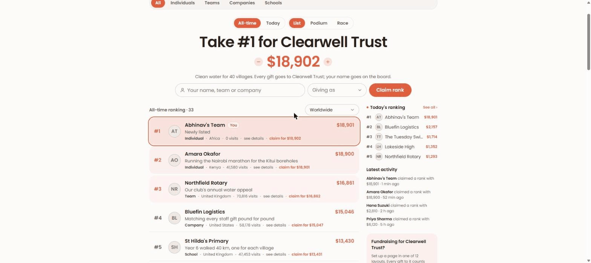

# Outgive

A white-label fundraising platform with a live-fundraising layer. A charity signs up, connects Stripe, brands its board and runs
campaigns, fundraiser pages, teams, challenges, events and in-memory pages on its own domain. Supporters hold ranks by what they
have given; anyone can take a rank by giving more than the person above them. Donors pay by card, Apple Pay, Google Pay or Link
through Stripe Checkout, get an emailed receipt, and watch their name climb a live board or wall display.

Design: `docs/superpowers/specs/2026-10-23-platform-design.md`. Deployment: `docs/RUNBOOK.md`.

Also included: a seven-step create flow (fundraiser, campaign, team, challenge, event, in memory) and 12 page layouts.
Every gift to a fundraising page counts toward that page's rank on the board.

Built with React 19, Vite, Tailwind CSS v4 and the open-source Untitled UI React components.

## Run it

    npm install
    npm run dev          # http://localhost:5173: with no .env the app runs the demo on an in-browser Postgres (PGlite)
    npm test             # schema, SQL API, RLS, seed, money and routing tests on real Postgres (PGlite)
    npm run test:fn      # Deno tests for the edge functions (fee maths, webhook mapping)
    npm run build        # production build in dist/ with prerendered marketing pages
    npm run test:browser # headless Chrome: every route, the claim/record/create flows, and a phone gift landing on the live screen

Copy `.env.example` to `.env.local` and fill in the Supabase URL and anon key to run against a real backend.
`docs/RUNBOOK.md` walks through Supabase, Stripe Connect, Resend and Vercel; the free tiers are enough to launch.

## How it is put together

    Browser (React SPA)
      └─ src/shared/lib/db.ts      one interface: rpc(name,args), auth, realtime, functions, uploads
           ├─ supabase mode   supabase-js (PostgREST RPC, Realtime, Auth, Storage)   when VITE_SUPABASE_URL is set
           └─ demo mode       PGlite in the browser, seeded with a sample charity    otherwise (/demo)
    Supabase
      ├─ Postgres: supabase/migrations/*.sql   tables, triggers, the SQL API (every read/write is a function), RLS
      └─ Edge functions: checkout, stripe-webhook, connect
    Stripe Connect ── webhooks ──▶ stripe-webhook ──▶ donations ──▶ realtime broadcast ──▶ boards and live screens

The app never queries tables directly; the SQL functions in the migration are the API, tested in `tests/db.test.ts`, and
behave identically in demo mode because the same migration runs in the browser.

Live fundraising: every organisation and page has a live screen (`/live`) in five layouts (classic, thermometer, impact, podium,
gift wall; dark or light), an OBS overlay (`/overlay`) and a phone give screen (`/donate`, or `/give` on a page) behind the live screen's QR code, where a
donor picks an impact item ("A borehole for a village, $6,000") or any amount and the gift lands on the screen in the room within a
second. The presenter console (Admin, Live screen) sets layout, theme, goal for the night, impact items, the ask banner and confetti.

Links are plain paths. On a charity's own domain (or after `/o/<slug>` on the platform):

    /donate                        give screen: pick an impact item or any amount
    /c/<slug>/donate               the page with the gift form open; /donate/50 prefills 50
    /c/<slug>/live                 live screen; /live/podium/light picks a layout and theme
    /c/<slug>/overlay              OBS overlay; /overlay/alert or /overlay/ticker for the other styles
    /c/<slug>/give                 the page's phone give screen (behind its live screen QR code)
    /c/<slug>/fundraise            start a fundraiser under this campaign
    /c/<slug>/embed                widget for another site; /embed/dark/10 on the board widget
    /thanks/<reference>            receipt after a gift

The same suffixes work on every page type (`/f`, `/t`, `/ch`, `/e`, `/m`) and org-wide (`/live`, `/overlay`, `/embed`).
Older query-string links (`?donate&amount=`, `?theme=`, `?layout=`, `?for=`, `?session_id=`) still resolve.

Tenancy: `<slug>.outgive.org` or a charity's custom domain resolves the organisation from the host; `/o/<slug>` works on the
bare domain. Tenant routes: `/` board, `/live` and `/overlay` (wall display and OBS overlay), `/c|/f|/t|/ch|/e|/m/<slug>` pages
(plus `/live`, `/overlay`, `/manage`), `/create`, `/admin`, `/thanks`, `/embed`.

## White label

Press **Your branding** on the leaderboard to see the board as your own charity: name, tagline, logo, brand colour,
font and default ranking layout. Four example charities are one click away. The colour you pick is turned into the
full brand scale (`src/shared/lib/brand.ts`), so buttons, tints, rank highlights and dark mode all follow it. The brand is kept
in `localStorage` and nothing leaves the browser.

## Three ranking layouts

- **List**: one row per supporter, the top three tinted.
- **Podium**: the top three on a stand (2, 1, 3), the rest as rows.
- **Race**: every row is a bar relative to #1, so the gap to the next rank is visible at a glance.

After you claim a rank, your row is marked **You** and scrolled into view in whichever layout is on.

## Where things are

    src/
      app/          wiring only: main.tsx, App.tsx (tenant, org loading, realtime, shared state), routes.tsx (lazy screens), prerender.tsx
      features/     one folder per product area; each exposes its public API in index.ts
        launch/       coming-soon landing and gate (eager: it is the first paint)
        marketing/    LandingB, Pricing, Info (About, Rules, FAQ, Terms, Privacy)
        auth/         Login, SignIn          onboarding/  Start (charity sign-up)
        leaderboard/  the board, 29 board styles, BrandPanel ("see it with your branding")
        campaign/     page screen, the 12 page layouts, PageManage (owner tools), page-parts (donate card, story, levels)
        create/       CreateFlow: the seven steps, live preview, published screen
        donate/       donate dialog, phone give screen, thank-you page
        live/         wall display, OBS overlay, embed widget, presenter console
        dashboard/    donor dashboard       admin/  organiser console
      shared/
        ui/           the design system; import only from "@/shared/ui"
        domain/       model.ts (page types, layouts, brand, currencies), types.ts (SQL API rows and adapters)
        lib/          db.ts (data interface), demo.ts (in-browser PGlite), route.ts, money.ts, brand.ts, seo.ts, app-context.ts, format.ts
        styles/       Tailwind 4 theme tokens, typography, globals
    supabase/migrations/   schema, triggers, SQL API, RLS; supabase/functions/: checkout, stripe-webhook, connect
    tests/                 db.test.ts (schema on real Postgres), seed.test.ts, browser/ (headless flows)

### Adding a blog post

Posts live in `src/features/blog/posts/<slug>.tsx`, one `Post` object each (title, description, the short answer,
takeaways, body, FAQ and sources), listed in `src/features/blog/posts.ts`. The build prerenders `/blog` and every post
with `BlogPosting`, `FAQPage` and breadcrumb JSON-LD, adds them to `sitemap.xml` with their `updated` date, and lists
them in `llms.txt`. Bump `updated` whenever you re-check a figure. Use `A`, `Table` and `Note` from `posts/kit.tsx` in bodies.

### Adding a feature

1. Create `src/features/<name>/` with `components/` and an `index.ts` that exports only what other code needs. Add
   `hooks/`, `api.ts` or `model.ts` when the feature has them, not before.
2. Give it a view in `src/shared/lib/route.ts` (and a test in `route.test.ts`), then one line in `src/app/routes.tsx`:
   `const Ramadan = screen(() => import("@/features/ramadan"), "Ramadan");`. Every feature is its own lazily loaded chunk.
3. Build the screens from `@/shared/ui`. If a component is missing, add it to `src/shared/ui/` and export it from
   `index.ts`, so the next feature can use it too. Style with Tailwind classes and theme tokens (`bg-primary`,
   `text-tertiary`, `bg-brand-solid`), never hard-coded colours; the charity brand and dark mode then apply automatically.

`src/app/boundaries.test.ts` enforces the rules on every `npm test`:

- `shared/` never imports `features/` or `app/`, and features never import `app/`.
- One feature reaches another only through its index (`@/features/live`, never `@/features/live/components/Live`).
- Features take UI only from `@/shared/ui`, never from its inner files or from react-aria directly.

`/ui` (dev only) shows every design-system component and variant in the current theme.

## Design system (`src/shared/ui`)

`base/`, `application/` and `foundations/` started as copies of https://github.com/untitleduico/react (MIT; licence in
`src/shared/ui/UNTITLED-UI-LICENSE`). They are now our own code: only the components the app uses were kept. `layout.tsx`,
`display.tsx`, `brand.tsx`, `dialog.tsx`, `search-bar.tsx` and `pill-select.tsx` are Outgive's own components on top of them.

One change was made to the copied source: in `base/select/select-native.tsx` the select only sets `aria-labelledby` when a
visible label is rendered, so an `aria-label` passed by the caller is respected.

## Not built yet

Auctions, raffles, text-to-give, crypto and stock gifts, Gift Aid claims, employer-match databases, SMS, CRM integrations.
Each is a table and a screen; nothing in the schema blocks them. Charity verification is a flag set by hand (see the runbook).
